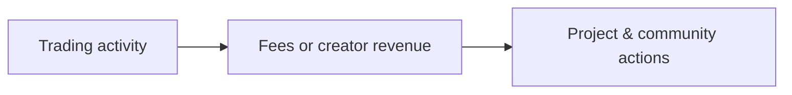
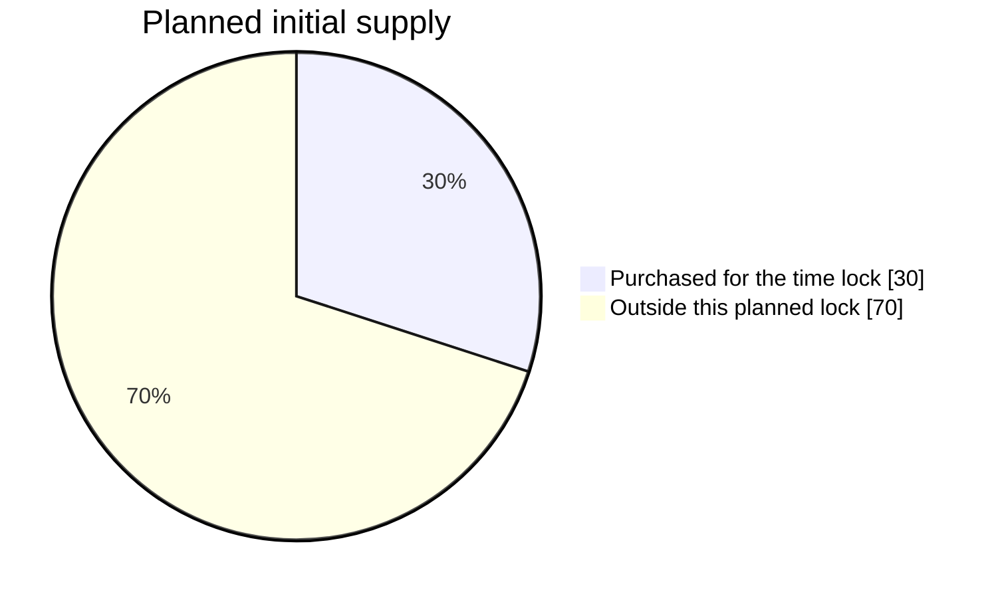
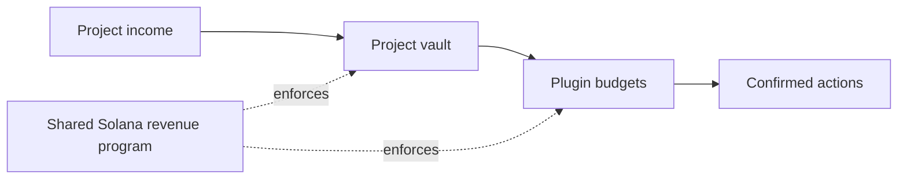
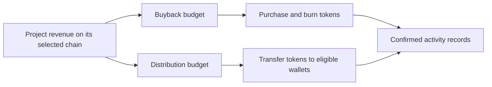

# SingleSpark Doc

From the first spark to a community. See where project funds are held, how shared on-chain plugins use them, and how to verify the results.

## Contents

- [Platform philosophy](#platform-philosophy)
- [Platform token economics](#platform-token-economics)
- [Project vaults & shared plugins](#project-vaults--shared-plugins)
- [Plugin playbook](#plugin-playbook)
- [Multi-chain plugin model](#multi-chain-plugin-model)
- [Transparency & participation](#transparency--participation)

## Platform philosophy

A meme starts with an idea. SingleSpark brings discovery, native token launches and revenue-powered plugins together so a community can follow what happens after launch.

### Start on familiar platforms

Launch through a supported platform with its native liquidity and trading rules. Choose the network and available tools that fit your project.

### Let activity support the community

Configured fees or creator revenue can fund buybacks, burns and token distributions. Each project follows its own selected rules.

### Make progress visible

Follow confirmed trades, plugin activity and transaction records. An enabled feature is a rule to execute, not evidence that it has executed.

This is the intended cycle. Market cap, user growth and individual project benefits depend on real demand.

## Platform token economics

**Planned · not live**

The SingleSpark platform token is planned for Robinhood / Pons; its SPARK testnet deployment is separate from historical ARC tokens and SSPTEST. Its governance model connects team token releases to a community satisfaction vote.

### Planned initial time lock

| Supply share | Purpose |
| --- | --- |
| 30% | Purchased for the time lock |
| 70% | Outside this planned lock |

The 30% is acquired by purchase, not a reserved mint allocation. The remaining 70% only describes supply outside this lock; it is not a separate team or community allocation.

### The community decides each release

Each planned vote lasts 24 hours. The winning side shares 10% of the daily token release, weighted by staking time. Its vote decides where the other 90% goes.

| Vote outcome | 90% of the daily release | 10% of the daily release |
| --- | --- | --- |
| If Satisfied wins | Released to the team | Winning voters |
| If Not satisfied wins | Permanently burned | Winning voters |

Governance is not live. The proposed daily release rate is 0.1%; its calculation basis, tie and no-vote rules, and final staking-time formula must be published before voting opens.

[Explore the DAO model](https://singlespark.fun/dao)

## Project vaults & shared plugins

A vault holds funds; a plugin defines an action. Projects keep separate balances, allocations and execution records even when they use the same plugin code.

### Solana · PDA vault + shared program

Each project has its own PDA vault for SOL, WSOL and distribution tokens. Buyback & burn and distribution run in one shared on-chain revenue program. Sharing the program does not share project balances or budgets.

A Solana PDA has no private key. Only the revenue program that derives it can authorize vault movement. The backend approves bounded strategies; Claim users sign and pay for execution. A shared program is not a shared fund pool.

Initial selections apply when registration confirms. Later plugin changes, weight changes, reactivation and program upgrades require a 48-hour timelock. Local or global emergency pauses take effect immediately and preserve funds.

A global pause covers current and future vaults under the same program configuration. Other configurations and chains remain separate. The DAO uses its own program and vaults.

### EVM · vault contracts

The EVM vault model holds project funds in smart contracts, with spending governed by the deployed contract and its permissions. Vault addresses, assets and execution rules belong to that network and deployment.

Existing EVM integrations also include custody-wallet revenue paths and separate treasury vaults. A treasury vault does not mean all plugin funds are held there. Check the deployment’s actual funds address; no automatic migration is implied.

Contract details and deployment boundaries: [Solana programs](../chains/solana/README.md).

## Plugin playbook

Plugins use the budgets assigned to a project’s vault. On Solana, projects select the built-in actions of the shared revenue program; launching a token does not deploy a new plugin contract. Follow current plugin status and confirmed results on the token page.

### Buyback & burn

Turn trading revenue into buybacks that permanently remove tokens from circulation.

1. Income received by the project funds its own buyback budget according to the configured allocation.
2. When the deployment’s budget, price and execution conditions are met, that budget buys tokens.
3. Purchased tokens are burned. Confirmed amounts and transactions appear on the meme’s page.

### Token distribution

Share a portion of trading revenue with eligible wallets through token distributions.

1. Income received by the project funds its own token distribution budget according to the configured allocation.
2. The deployment selects eligible wallets and waits for enough tokens and gas to execute.
3. Tokens are sent to eligible wallets. Eligibility, payout amounts and timing follow the launch’s rules.

### Choose your project’s combination

Buyback & burn removes tokens from supply. Distribution sends project tokens to eligible wallets. Both can use separate budgets. On Solana, pausing a plugin preserves its funds; later policy changes apply after the timelock and do not redistribute existing budgets.

Plugin availability is shown for each chain and launch platform. A listed platform may still be a preview; enabling a plugin does not mean a buyback or distribution has already executed.

[Browse plugins & supported platforms](https://singlespark.fun/plugins)

## Multi-chain plugin model

SingleSpark uses one plugin workflow across supported chains and launch platforms: choose the project, enable available plugins, fund their budgets and verify each completed action.

The selected launch platform sets its native launch and trading fees. Review those fees, the project’s plugin settings and current availability before confirming.

### Revenue & plugin budgets

Trading fees or creator revenue fund the project’s configured plugin budgets. Fee allocations apply to revenue actually received after the launch platform’s own charges, not to the full trade amount.

On Solana, successful execution books available vault income above reserved budgets, excluding rent. This includes externally collected fees and voluntary deposits; allocated income alone does not prove that every deposit came from trading fees.

### 1. Fund separate budgets

Received income is allocated within the project’s vault. Buyback, distribution and other configured budgets stay separate; one project cannot spend another project’s funds.

### 2. Execute when ready

Execution checks plugin permissions, pause gates, funding and market limits. Distribution also needs eligible recipients and enough tokens. Solana Claim users review and sign each transaction; a funded budget does not execute itself.

### 3. Verify the result

Buybacks purchase tokens for burning; distributions transfer tokens to eligible wallets. Follow confirmed amounts, recipient counts and transaction links on the token page.

The product model is shared across chains; contract code, balances and transactions stay on their own network. Funds are not automatically pooled or bridged between networks. Public launches support ARC / Argus and the explicitly authorized Robinhood Testnet / Pons integration; other networks remain disabled; an EVM vault description or catalog entry does not enable public execution.

## Transparency & participation

Use the token page and public activity records to check what a project has actually done. Keep the following distinctions in mind when exploring the platform.

- Check the chain, token, project vault, shared program or contract, and current plugin status. On Solana, local and global pauses both affect execution. Existing deployments retain their own custody and upgrade rules.
- A budget or countdown is not a completed transaction. Burns and distributions appear as confirmed activity only after execution; open the transaction to verify it.
- DAO participation will open when its Solana governance is available. Until then, the displayed model describes the plan, with no live staking or voting.

[Explore tokens](https://singlespark.fun/tokens) · [View confirmed burns](https://singlespark.fun/burn)

## ARC/Argus contract revenue vaults

New projects use `ArgusVaultFactory` + `ArgusRevenueVault`: separate balances and on-chain budgets, shared code, immediate pause, fixed 48-hour policy/resume/upgrade delay. The existing router and legacy EOA launches remain bound to their original deployment. Deployment, durable recovery and local-fork verification are documented in [docs/arc/vaults.md](arc/vaults.md). Deployment is explicit; changing code alone does not alter any mainnet recipient.

The independent [EVM gameplay protocol](evm/protocol.md) adds `GameplayVaultFactory` for registering already deployed project tokens, with one native/ERC20 funding asset per project Vault, isolated plugin budgets, delayed code registration and user-paid Claim execution. `forge test --root chains/evm` verifies the contracts, including native-currency Uniswap v4 swaps without WETH. This is a local contract/interface delivery; it does not replace deployed Argus contracts, migrate fees or enable additional public chains/platforms.

## Source ownership and build entrypoints

Contract implementations follow chain-common and launchpad-specific ownership under `chains/`. `chains/evm` holds shared EVM governance, execution and revenue contracts; `chains/arc/launchpads/{argus,singlespark}` holds protocol-specific contracts. Solana shared state, governance and DAO/timelock entrypoints live under `chains/solana`; Pump revenue lives in `chains/solana/launchpads/pump`. `chains/bsc/launchpads/four-meme` contains interface metadata only.

`chains/arc/` and `chains/solana/` own the build profiles and ABI exports. Maintained callers use the relocated artifact roots; deployed bindings and frozen compiler source keys do not change. No contract is redeployed or vault migrated by moving source. Run the workspace architecture check plus `test:contracts`, `test:arc-contracts` and `test:sol-contracts` after source moves.
## Robinhood / Pons environments

Verified on-chain sources are pinned in `chains/robinhood/launchpads/pons/sources.json`, with operational entrypoints in `scripts/robinhood/launchpads/pons/testnet/`. Public records separate `chains/<chain>/deployments/testnet/`, `mainnet/` and `local/`; deployed addresses and private signed recovery journals retain their original bindings and contents. See [deployment environments](deployments.md) and [Pons test deployment](robinhood/pons.md).
